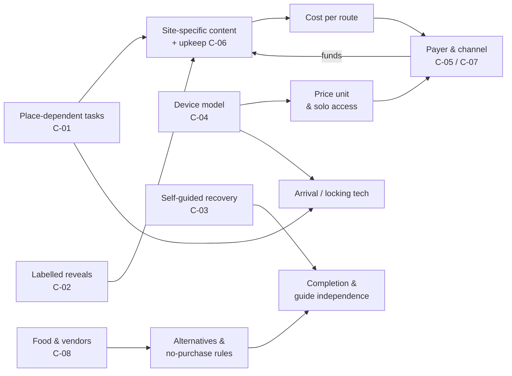

# DORI Competitive Research — Phase 4 Synthesis

**Date:** 3 Nov 2026 · **Basis:** Phase 1 taxonomy, Phase 2 matrix, Phase 3 strategy profiles (SRC-001–102), plus a targeted branching search (SRC-103–107, 3 Nov 2026). · **Library:** `DORI_Research_Library.xlsx`\
**Status:** every conclusion, white space and hypothesis is a **research proposal pending owner decision**. Nothing has been approved.

---
## 1. Conclusions

### C-01. Place dependence is the clearest available differentiator, but its value to players is unproven

- **Competitor observation:** Only the Adventure Lab demo shows tasks that need the place (DEMO). Eskap reuses one script across 60+ cities, and a reviewer says it barely uses the surroundings (DOC + REVIEW). Explorama's and Actionbound's own example questions are remote-answerable trivia.
- **Underlying mechanism:** Portable content costs almost nothing per new city, so it scales. Place-locked observation forces site-specific writing and upkeep. Authoring tools do not enforce place use, so they default to trivia.
- **Relevance to DORI:** Directly tests DORI's 'learning before mechanics' principle. The hotel-room test separates DORI from portable competitors only if players notice and value it.
- **Alternative approaches:** (a) Fully site-specific; (b) mixed: a template structure with local content, as Gymkana DT does; (c) portable core with a place-locked optional layer.
- **Constraints:** Changing market stalls, crowds, Shabbat and opening hours; upkeep cost per stop.
- **Risks:** Players may not perceive or pay for place depth. Site-specific content limits expansion speed.
- **Uncertainty:** Medium confidence on the competitor pattern (one DEMO, two REVIEWs). LOW on player value: no evidence at all.
- **Proposed validation:** H-01 hotel-room A/B (remote vs on-site solve rate); H-02 preference and recall test with 10–20 visitors.
- **Evidence:** SRC-047; SRC-008; SRC-013; SRC-014; FND-014; FND-081; LINK-001; REL-03; REL-04 · **Linked opportunity:** OPP-001 · **Layers:** Gameplay · Education · Content ops · Commercial

### C-02. Interpretation is the least-occupied layer: evidence labelling is invisible, and branching on real history was not found

- **Competitor observation:** EDU-LABEL is NOT TESTED or N/A for all 22 entities, and no learning evaluation was found. Branching location stories do exist: Story City sells routes that 'branch off into dozens of different locations' with alternative endings (DOC), and StoryPlaces supports branching structures (DOC). But their branching examples are fiction, and history is sold as linear walking tours (REVIEW). A study of AR location stories found narratives were mostly linear (EVAL). No perspective-choice history game turned up in 4 EN/FR/ES searches.
- **Underlying mechanism:** Fiction lets authors invent consequences for choices; real history fixes the outcomes, so operators keep it linear (INFER). Labelling only shows during play, and competitors don't market it.
- **Relevance to DORI:** Two connected options for DORI's 'evidence and interpretation remain distinct' principle: (1) label each reveal as fact, legend or interpretation; (2) let groups choose WHOSE story to follow — for example a market trader, an immigrant family or a neighbourhood resident, each grounded in sources. Groups take different paths without fiction, and multi-perspective interpretation becomes the mechanic itself.
- **Alternative approaches:** (a) Explicit labels per reveal; (b) a narrator voice that marks speculation; (c) a sources panel only; (d) perspective-choice branches with a shared finale; (e) fiction branches, clearly labelled as fiction.
- **Constraints:** Source research per perspective; contested Jerusalem narratives; content multiplies with each branch (REL-05); label clutter on mobile.
- **Risks:** Token or stereotyped perspectives; uneven depth between branches; groups missing each other's story (a shared finale is a possible mitigation, INFER); labels may reduce immersion.
- **Uncertainty:** Low. Labelling and perspective branching are absent from what we saw, but play and Jerusalem were not searched.
- **Proposed validation:** H-03 playthroughs (do competitors label?); H-04 label vs no-label test; H-12 test of linear vs fiction branching vs perspective branching (recall, enjoyment, replay intent).
- **Evidence:** Phase 2 Matrix EDU-LABEL; ADV-003; FND-111; FND-113; FND-114; FND-115; FND-116; SRC-103; SRC-104; SRC-105; SRC-106; BS-01; BS-02 · **Linked opportunity:** OPP-001; OPP-011 · **Layers:** Education · Narrative · Gameplay · Content ops

### C-03. Recovery design splits into three models; none is documented for one-off tourists

- **Competitor observation:** Scarcity: Tèrra gives 1 aid + up to 3 jokers, refilled after 10 caches (DOC, contradicted). Costed: Actionbound point deductions (DOC), Secret City Trails time penalties (third-party REVIEW), CityDays (DOC). One answer only: BeeTravel (DOC). Help mechanics are UNKNOWN for 10 of 14 platforms.
- **Underlying mechanism:** Scarcity rewards repeat players. Costs keep scores meaningful. One-answer rules stop guessing but end learning from mistakes.
- **Relevance to DORI:** Self-guided by default means DORI must recover without a guide. Its visitors are mostly one-off, so Tèrra's refill model does not transfer.
- **Alternative approaches:** (a) Costed hint ladder plus reveal-and-continue; (b) free hints with no score; (c) guide-unlockable help in B2B.
- **Constraints:** Mobile text length; group disagreement over hint use.
- **Risks:** Over-hinting removes observation. Penalties feel punitive to families.
- **Uncertainty:** Medium on the pattern; low on exact values (mostly NOT PUBLIC).
- **Proposed validation:** H-05 costed vs free ladder test (completion, reveal rate, recall); free demos (Goosechase, Actionbound) for UI patterns.
- **Evidence:** SRC-030; SRC-032; SRC-050; SRC-057; SRC-059; SRC-067; TO-06; REL-11; REL-13 · **Linked opportunity:** OPP-002 · **Layers:** Gameplay · Player journey · Education

### C-04. The device model is a hidden strategic choice: it fixes price unit, participation and solo access together

- **Competitor observation:** Eskap: a phone per player, per-person price, minimum 2. Mifrasim: one phone for about 6 people, per-phone price. Questo: packs of 1, 2 or 5 phones with shared progress and solo possible. Urban Quest: one phone per team (all DOC).
- **Underlying mechanism:** Required devices raise cost per group and exclude solo players. Shared phones are cheap but let one person dominate (INFER). Device packs separate price from head-count.
- **Relevance to DORI:** DORI serves solo, family and B2B. The device model decides checkout ('ask number of participants'), family cost and team play together.
- **Alternative approaches:** (a) Per-device packs with shared progress; (b) per-person pricing; (c) one phone with role prompts; (d) B2B seat licence.
- **Constraints:** Device sync; battery; children without phones.
- **Risks:** Price per head vs price per device can feel unfair to large or small groups.
- **Uncertainty:** High on competitor facts; unknown on DORI willingness to pay.
- **Proposed validation:** H-06 pricing test (per device vs per person) for families; H-07 paired-phone vs single-phone participation test.
- **Evidence:** SRC-009; SRC-011; SRC-068; SRC-053; SRC-062; REL-07; REL-08; REL-09; TO-04 · **Linked opportunity:** OPP-004 · **Layers:** Player journey · Technology · Commercial · Social

### C-05. Two commercial worlds — player-paid and destination-funded — rarely meet; the Israeli B2G side is unresearched

- **Competitor observation:** Player-paid games sell through marketplaces and city SEO (Questo via Tripadvisor/Eventbrite; Mifrasim and BeeTravel via iTravelJerusalem; Eskap via city pages). Destination-funded games are free to players and sold to public bodies: Baludik, Tèrra, Gymkana DT (Barcelona subsidy), Play&go (licences + data), JustGame (procurement).
- **Underlying mechanism:** Public bodies buy promotion and visitor spread; players get free access. Consumer games recover content cost per sale.
- **Relevance to DORI:** DORI's B2C, guide and school segments fit the player-paid side. Destination funding could pay for place-specific content, but no Israeli evidence exists.
- **Alternative approaches:** (a) B2C only; (b) B2C plus B2B guides and schools; (c) add commissioned municipal or heritage routes.
- **Constraints:** Public budgets and procurement cycles; publicly funded content may need to be free and generic.
- **Risks:** Dependence on budgets; mission drift toward promotional content.
- **Uncertainty:** Medium for France and Spain; UNKNOWN for Israel.
- **Proposed validation:** H-08 scan of Israeli tourism and municipal procurement, plus 5 interviews (municipal tourism, heritage bodies).
- **Evidence:** SRC-053; SRC-054; SRC-066; SRC-068; SRC-019; SRC-031; SRC-090; SRC-094; SRC-096; Strategy_Map_1; TO-02 · **Linked opportunity:** — · **Layers:** Commercial · Content ops

### C-06. Content operations, not features, decide whether place-based quality survives

- **Competitor observation:** Explorama documents in-situ testing and flags 0%-success missions. Tèrra lists routes 'en maintenance'. Secret City Trails reviews report clues hidden by construction and markets, and translation errors. Strict sequences broke on an inaccessible stage (Adventure Lab).
- **Underlying mechanism:** Place-dependent content decays as places change. Analytics and re-walks catch it; open order limits the damage.
- **Relevance to DORI:** Mahane Yehuda changes stalls and signage often. DORI's guide-authored videos and sources add production and upkeep load.
- **Alternative approaches:** (a) Prefer fixed features; (b) open-order clusters; (c) player reporting plus analytics; (d) scheduled re-walks.
- **Constraints:** Staff time; analytics need connectivity (Explorama loses stats offline).
- **Risks:** Silent content rot erodes trust.
- **Uncertainty:** Medium on competitor practice; UNKNOWN on the Mahane Yehuda change rate.
- **Proposed validation:** H-09 re-walk 3 stops monthly for 3 months and log changes; time the authoring of 1 stop end to end.
- **Evidence:** SRC-001; SRC-003; SRC-032; SRC-058; SRC-049; REL-02; REL-05; REL-17; REL-18; BS-08 · **Linked opportunity:** OPP-003; OPP-005 · **Layers:** Content ops · Technology · Gameplay

### C-07. The Jerusalem field is thin, Hebrew-first and group-on-one-phone; an English self-guided place game is unconfirmed as a gap

- **Competitor observation:** Mifrasim and BeeTravel (Hebrew) cover Mahane Yehuda with one phone per group or per game. Questo Jaffa is English-only. Tali Friedman offers English/Hebrew audio, not a game. Mifrasim and BeeTravel are the least documented entities (8 coded cells each).
- **Underlying mechanism:** Local operators target Hebrew families through the municipal portal. International platforms appear in Jaffa; Jerusalem market coverage by them was not checked.
- **Relevance to DORI:** DORI's English-speaking visitor segment may be under-served in Mahane Yehuda.
- **Alternative approaches:** (a) English-first; (b) bilingual EN/HE; (c) partner with local operators.
- **Constraints:** RTL and bilingual content cost.
- **Risks:** The gap may not exist: Questo, Secret City Trails and marketplaces were not swept for Jerusalem.
- **Uncertainty:** Low: unresearched.
- **Proposed validation:** H-10 desk sweep of Questo, Secret City Trails, Fever, GetYourGuide and Viator for Jerusalem market games (1–2 h); then a Mifrasim playthrough.
- **Evidence:** SRC-065; SRC-066; SRC-068; SRC-053; SRC-069; BS-09; OQ-012 · **Linked opportunity:** — · **Layers:** Commercial · Player journey

### C-08. Food appears as theme, coupon or bundle — a no-purchase tasting mechanic is not observed

- **Competitor observation:** Mifrasim's food-market route excludes paid tastings. Tali Friedman and Tèrra give vendor coupons. El Secreto and the Madrid tapas gymkana include food in the ticket. No self-guided food game was found in Spain.
- **Underlying mechanism:** Purchases add cost, allergy and vendor-logistics risk, so operators either avoid food or bundle it.
- **Relevance to DORI:** Tasting is an owner research lens (OPP-010, status unresolved). Competitors suggest constraints, not a model.
- **Alternative approaches:** (a) Observation of food (no eating); (b) optional purchase with an equal non-taste path; (c) vendor partnership with bundled tokens.
- **Constraints:** Allergies, kashrut, vendor availability and consent, cost.
- **Risks:** Implied pressure to buy; vendor fatigue.
- **Uncertainty:** Low: mechanics are invisible publicly.
- **Proposed validation:** H-11 Mifrasim playthrough focused on food; 5 vendor interviews.
- **Evidence:** SRC-068; SRC-069; SRC-035; SRC-098; SRC-099; BS-05; FIT-15 · **Linked opportunity:** OPP-010 · **Layers:** Gameplay · Partnerships · Commercial

---
## 2. System analysis: how the choices connect

DORI's design choices are linked. A choice in one layer narrows the options in others.

| Layer | DORI choice point | Depends on | Constrains | Evidence |
|---|---|---|---|---|
| Gameplay | Place-dependent observation tasks (C-01) | Arrival/locking tech; fixed physical features | Content cost, upkeep, portability | SRC-047; SRC-014 |
| Education | Reveal after task with evidence labels (C-02) | Editorial research; source records | Text length; production time | SRC-001; SRC-068 |
| Player journey | Self-guided recovery: help ladder and continue (C-03) | Scoring or cost model | Completion, frustration, guide dependence | SRC-030; SRC-050 |
| Social / devices | Device model (C-04) | Sync tech; checkout design | Price unit, solo access, participation | SRC-009; SRC-053; SRC-068 |
| Technology | Delivery (app vs web), offline, analytics | Device model; locking needs | Onboarding friction; content-health data | SRC-003; SRC-056; SRC-062 |
| Content operations | Authoring, field test, re-walk (C-06) | Place dependence; labelling depth | Scale speed; cost per stop | SRC-001; SRC-032; SRC-058 |
| Commercial | Payer and channel (C-05, C-07) | Content cost per route; device model | Who the product must please; reach | SRC-053; SRC-090; SRC-094 |
| Narrative / branching | Perspective-choice branching (C-02) | Source research per perspective; a shared finale | Content volume per route; score comparability; upkeep | SRC-103; SRC-105 |
| Partnerships | Food and vendors (C-08) | Purchase rules; accessibility alternatives | Logistics; consent; cost | SRC-068; SRC-069 |

**Core tension (INFER):** the features that best express DORI's principles — place dependence, labelled reveals and self-guided recovery — all raise content cost per route. The competitors that scale fastest avoid exactly those costs (Eskap's portable template; creator platforms). So the content-operations model and the payer have to fit the educational choices: a premium per-device consumer price, B2B guide or school fees, or commissioned routes. The evidence does not yet show which of these will work in Israel.

---
## 3. Strategic white spaces

| ID | Candidate | Status | Basis | To confirm |
|---|---|---|---|---|
| WS-01 | Consumer self-guided place game with an optional guide/organizer layer | Evidence-supported (moderate) | Consumer games document no organizer console; organizer tools (Goosechase, Actionbound) document consoles but organizer-defined, non-place content (DOC). Both types would normally advertise such features. | Check 3 consumer games' B2B pages; one demo of a Goosechase-style console |
| WS-02 | Fact / legend / fiction labelling in reveals | Unresearched | Not observable without play (NOT TESTED everywhere) | Playthroughs H-03 |
| WS-03 | Published learning outcomes | Unresearched | Academic search not done (OQ-011); one university repository lead (SRC-100) | Academic search |
| WS-04 | English self-guided place game in Mahane Yehuda | Unresearched | Hebrew local operators found; international catalogues not swept for Jerusalem | Desk sweep H-10 |
| WS-05 | No-purchase tasting mechanic | Not observed; mechanics invisible | Food only as theme, coupon or bundle (DOC) | Playthrough H-11 |
| WS-06 | Destination-funded routes in Israel | Unresearched | French/Spanish B2G evidence only | Procurement scan H-08 |
| WS-07 | Content-health monitoring for changing markets | Not observed in consumer games; would rarely be advertised | Only Explorama/Goosechase document analytics | Operator interviews |
| WS-08 | Solo + family + team in one product with fair pricing | NOT a gap | Questo already offers device packs, solo play and shared team progress (DOC) | — |
| WS-09 | Choice-driven branching routes in general | NOT a gap | Story City sells branching fiction location stories (DOC, SRC-103/104); StoryPlaces supports branching (SRC-105) | — |
| WS-10 | Perspective-choice branching on evidence-based history (whose story to follow) | Unresearched | Not found in 4 EN/FR/ES searches; branching examples seen are all fiction (SRC-103/104); Jerusalem and Hebrew not searched | Wider sweep incl. Hebrew + Story City non-fiction catalogue (OQ-019) |

**Only one candidate (WS-01) is evidence-supported, and only moderately.** Seven are unresearched or cannot be seen without play. Two are rejected because a competitor already does them: Questo (solo + team) and Story City (branching in general). Perspective-choice branching on real history (WS-10) is unresearched, not a proven gap. Do not present the unresearched candidates as market gaps.

---
## 4. Prioritized research hypotheses

| # | ID | Hypothesis | Conclusion | Metric | Threshold (proposed) | Method | Cost | Time |
|---|---|---|---|---|---|---|---|---|
| 1 | H-01 | Place-dependent tasks are much harder to solve remotely than on site | C-01 | Solve rate remote vs on site | Remote ≤ 30% of on-site rate | 3-stop paper prototype; 10 remote + 10 on-site testers | Free | 1–2 weeks |
| 2 | H-10 | No English self-guided game currently covers Mahane Yehuda | C-07 | Count of English market games in catalogues | 0 found = gap candidate | Desk sweep: Questo, SCT, Fever, GetYourGuide, Viator | Free | 1–2 hours |
| 3 | H-03 | Nearest competitors do not label fact vs legend and use generic reveals | C-02 | Share of reveals with source/label; LOC-PLACE per stop | Observed per stop | Paid playthroughs: Mifrasim + Questo Jaffa (2 observers) | ₪140–219 + €22.99 | 1 week |
| 4 | H-05 | A costed help ladder with reveal-and-continue keeps completion high without killing observation | C-03 | Completion; reveal rate; recall after 1 day | Completion ≥ 90%; reveal ≤ 25% of stops | A/B: costed vs free ladder, 6 groups each | Low | 2–3 weeks |
| 5 | H-07 | Paired phones with complementary info raise participation over one shared phone | C-04 | Share of members who act per stop | +30% participation | 5 families, paper prototype | Low | 2 weeks |
| 6 | H-09 | Mahane Yehuda clue features change often enough to need monthly checks | C-06 | Changed or blocked clues per month | > 10% of stops/month = monthly check | Re-walk 3 stops monthly × 3 months | Free | 3 months |
| 7 | H-06 | Families prefer per-device packs to per-person pricing at the same total | C-04 | Stated preference; fake-door conversion | ≥ 60% prefer | Survey or fake-door page | Low | 2 weeks |
| 8 | H-02 | Visitors who do place-dependent tasks recall more and rate the experience higher | C-01 | Recall score; enjoyment rating | Recall +20% | Field test with 10–20 visitors | Low | 3–4 weeks |
| 9 | H-12 | Branching works for history through perspective choice, not only fiction: perspective branches match linear on recall and beat it on enjoyment and replay | C-02 | Recall; enjoyment; replay intent; perceived fairness between branches | Recall ≥ linear; enjoyment +20% | Paper prototype: linear vs fiction branch vs perspective branch × 5 groups | Low | 3–4 weeks |
| 10 | H-04 | Evidence labels increase trust without reducing enjoyment | C-02 | Trust and enjoyment ratings | Trust ↑, enjoyment ≥ baseline | Label vs no-label A/B | Low | 3 weeks |
| 11 | H-08 | Israeli municipal or heritage bodies commission gamified routes | C-05 | Contracts found; interview interest | ≥ 3 contracts or 2 interested bodies | Procurement scan + 5 interviews | Free | 3–4 weeks |
| 12 | H-11 | A no-purchase food observation task works as well as tasting for engagement | C-08 | Engagement; vendor acceptance | Equal engagement | Mifrasim playthrough + 5 vendor interviews + prototype | Low | 3–4 weeks |

Priority = information value relative to cost and time. The thresholds are starting points for the owner to set.

---
## 5. Opportunity register review (status unchanged; owner decides)

| OPP | Title | Phase 4 link | Evidence change | Status |
|---|---|---|---|---|
| OPP-001 | Place-locked observation + evidence-labelled reveal | C-01; C-02 | Strengthened (Phase 2 contrast; Phase 3 TO-01). Player value still untested. | candidate |
| OPP-002 | Bounded help ladder + 'completely stuck' continue | C-03 | Field splits into three models; no tourist-focused model documented. | candidate |
| OPP-003 | Open-order clusters + saved progress | C-06 | Open order is still route-specific (Baludik); fragility evidence supports it. | candidate |
| OPP-004 | Complementary-info team + solo fallback | C-04 | Device model linked to price and solo access (REL-07–09). | candidate |
| OPP-005 | Creator field verification + health monitoring | C-06 | Spain adds no new evidence; Explorama remains the only documented case. | candidate |
| OPP-006 | Digital collectible discoveries | — | No new evidence. | candidate |
| OPP-007 | Optional leaderboard + guide overview | WS-01 | Organizer-layer gap moderately supported. | candidate |
| OPP-008 | Spoiler-safe guide video | — | Still zero competitor evidence (OQ-014). | candidate |
| OPP-009 | Market Surprise | — | Still no competitor evidence; status discrepancy unresolved (OQ-015). | proposed |
| OPP-010 | Tasting as a challenge mechanic | C-08 | Spain: food only bundled. Mechanics unseen. | proposed |
| OPP-011 | Perspective-choice branching (whose story to follow) | C-02; H-12; WS-10 | NEW (owner interest, 3 Nov 2026). Branching exists for fiction (Story City); no history version found. | proposed |

---
## 6. Research-completion audit

| Objective | Target | Actual | Status |
|---|---|---|---|
| Handoff 1 · platform profiles | 15–20 | 18 profiled (14 + 4 Spain) + 1 lead + 2 branching references | Completed with limitations |
| Handoff 2 · substantial adventure/demo profiles | 5–8 | 4 substantial, 4 moderate, 1 lead | **Partially completed** |
| Handoff 3 · challenge evidence only where public | Where available | 1 partial (CHL-001); none fabricated | Completed with limitations |
| Handoff 4 · searchable matrix with negatives | Linked library | 22×45 matrix; 361 of 929 applicable cells coded; 12 negatives | Completed with limitations |
| Handoff 5 · testable opportunities | 3–5 | 11 OPP; 8 conclusions; 12 hypotheses; none validated | Completed (as documents) |
| Handoff 6 · next research recommendation | Short | Ranked hypotheses with cost and time | Completed |
| Handoff 7 · intelligence vs approval | Clear | 0 approved; OQ-015 open | Completed |
| Phase 1 · taxonomy + Spain pilot | Limits met | 18 dims, 123 props, 4 pilot products | Completed with limitations |
| Phase 2 · comparison | 14 + 8 | All coded; 515 UNKNOWN, 57 NOT TESTED | Completed with limitations |
| Phase 3 · strategy | Significant competitors | 18 profiles; 57 fields INFER | Completed with limitations |
| Phase 4 · synthesis + library | 5–8 conclusions | 8 conclusions; library 44 sheets; 5,999 ID refs, 0 unresolved | Completed with limitations |

## 7. Evidence-gap audit

| Area | Finding |
|---|---|
| Evidence mix (116 findings) | DOC 89 · REVIEW 17 · DEMO 3 · INFER 3 · UNKNOWN 3 · EVAL 1 (general AR-story study, not a competitor) · FIELD 0 |
| Matrix (929 applicable cells) | 361 coded (DOC 304, REVIEW 29, DEMO 6, INFER 22) · 515 UNKNOWN · 57 NOT TESTED |
| Sources (107) | 4 legacy claims not re-verified; 18 unverified (search results or bibliography entries not opened) |
| Least-known properties | EDU-LABEL and ACC-ALTS 0/22 assessed · LOC-PLACE 2/22 · hint cost and skip 4/14 platforms |
| Least-known entities | Mifrasim and BeeTravel (Jerusalem): 8 coded cells each |
| Not done | 0/4 free demos joined · 0/3 paid playthroughs · no registry data · no academic search · no Hebrew/Old City sweep · no English Jerusalem catalogue sweep · no Israeli procurement scan · branching search EN/FR/ES only (Hebrew and Jerusalem not covered) |
| Method limits | One researcher coded everything; no independent second reviewer. Spain pilot is 13 sources. Prices are snapshots dated Nov 2026. |
| What online research cannot answer | Completion, stuck points, learning, enjoyment, margins, market share — these need company data, play, field tests or evaluation |

**Bottom line:** the research base is good enough to frame hypotheses, not to make product decisions. The cheapest next steps that would change confidence most are H-01 (free), H-10 (1–2 hours) and two paid playthroughs (H-03).
