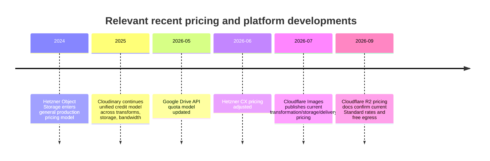
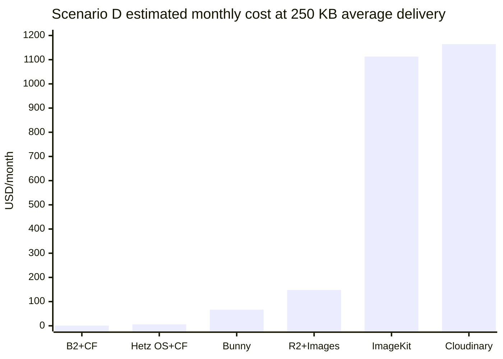
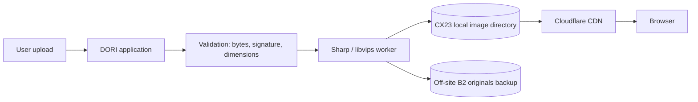
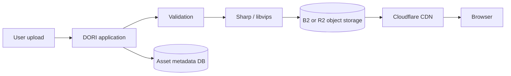
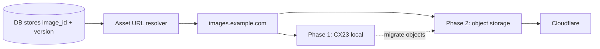

# DORI Image Hosting Strategy: Cost, Performance, and Migration Research

## Executive recommendation and decision matrix

DORI’s cheapest credible production architecture is **Hetzner CX23 local storage + upload-time image generation with Sharp/libvips + Cloudflare CDN**, provided the image library remains comfortably inside the VPS’s 40 GB NVMe disk and DORI maintains a real off-site backup of the original uploads. The CX23 currently provides 2 vCPU, 4 GB RAM, 40 GB NVMe, and 20 TB of included monthly traffic in EU locations; Cloudflare’s Free plan includes CDN delivery, and static images are cacheable by default. citeturn148034search0turn148034search2turn194400search0turn683464search7 The existing VPS cost is a sunk cost for this decision; the meaningful incremental costs are backups, any future attached storage, and operational effort. Hetzner server backups cost 20% of the server price and provide seven backup slots, although they do not include attached Volumes. citeturn683464search3turn323714search0

For DORI’s modeled launch and early-growth workloads, I would therefore start with **three pre-generated widths, immutable URLs, a dedicated `images.` subdomain, Cloudflare caching, and off-site copies of originals**. This avoids recurring image-service fees while delivering the main performance benefits that matter on mobile: correctly sized assets, WebP/AVIF, long-lived edge caching, `srcset`, and reduced LCP transfer time. Google’s web-performance guidance specifically notes that responsive images reduce unnecessary mobile data and can improve LCP. citeturn679391search1turn679391search3 Sharp supports JPEG, WebP and AVIF output and uses libvips, whose demand-driven design is intended to keep memory use relatively low. citeturn679391search17turn679391search16

The best **managed low-cost architecture** is **Bunny Storage + Bunny CDN + Bunny Optimizer** when you genuinely want dynamic transformations. Bunny currently charges $0.01/GB for single-region standard storage, region-dependent CDN bandwidth starting at $0.01/GB in Europe/North America, and **$9.50/month per Pull Zone** for Optimizer with unlimited transformation requests; its account minimum is $1/month. citeturn677496search3turn677496search4turn677496search5turn677496search6 The best **future-growth architecture when keeping image processing under DORI’s control** is **Backblaze B2 + Cloudflare CDN + upload-time Sharp/libvips processing**: B2’s published rate starts at $6.95/TB-month, the first 10 GB is free, API calls are generally free for PAYG workloads, and egress through partner CDNs including Cloudflare is free. citeturn677496search7 This produces object-storage durability and scalability at a fraction of managed-image-platform pricing.

Cloudflare R2 + Cloudflare Images is technically excellent and operationally simple, but dynamic transformations become material when the number of distinct image-size combinations grows: the Images Free plan includes 5,000 unique transformations per month, with Paid pricing at $0.50 per additional 1,000 unique transformations; R2 Standard storage is $0.015/GB-month after a 10 GB monthly free tier and has zero Internet egress charges. citeturn148034search4turn148034search5 Cloudinary is the strongest fully managed option in this comparison, but its current credit model makes it uneconomic for DORI unless the operational value of its DAM, transformation, workflow, and administration features is worth roughly $99–$1,100+ per month at the modeled scales. citeturn686743search0turn579904search1

The modeled scenarios below are the user-supplied illustrative workloads, not measured DORI traffic. fileciteturn0file0

| Stage | Recommended architecture | Approx. incremental monthly cost at 250 KB delivered payload | Main tradeoff | Measurable upgrade trigger |
|---|---|---:|---|---|
| Launch / MVP | CX23 local + Cloudflare + pre-generated variants | about **$1.30** if server backup is newly enabled; potentially less if already enabled | Single-server storage risk; manual image pipeline | Images consume **>60–70% of usable disk**, restore tests become slow, or upload processing materially affects app latency |
| Growing | **B2 + Cloudflare + pre-generated variants**, processing on CX23 | **$0–$0.10** storage in scenarios B–C under modeled assumptions | You own optimization logic | Need arbitrary dynamic crops/sizes, signed private media, or creative transformations |
| High traffic | B2 + Cloudflare + Sharp, or Bunny if dynamic transformation becomes valuable | about **$0.59** for B2 storage in scenario D; Bunny about **$66.70** with the modeled geographic mix | B2 is DIY; Bunny has bandwidth fees | Pay for Bunny when engineering/ops cost of maintaining the transform pipeline exceeds roughly **$10–$70/month** or product needs many on-demand variants |
| Fully managed | Cloudinary | **$99–$1,164+** across B–D | Highest recurring cost; proprietary API surface | Choose when its workflow/DAM/AI/administration replaces enough engineering work to justify the premium |

**Confidence in the core recommendation: High, about 0.88.** The main uncertainty is not provider pricing but DORI’s actual retained-image footprint, geographic user mix, and how many distinct image sizes/crops the product will need.

## Verified pricing, recent developments, and provider assessment

All monetary values below are published list prices verified **November 5, 2026**. Taxes are excluded where providers publish net pricing. Prices may vary by region, contract, payment term, or future changes.

| Provider | Storage | Bandwidth / egress | Requests | Optimization | Fixed fees | Free tier | Source | Verified date |
|---|---:|---:|---:|---:|---:|---|---|---|
| Hetzner CX23 local disk | 40 GB NVMe included in server | EU CX includes 20 TB/mo; excess €1/TB according to Hetzner traffic docs | None | DIY | Existing VPS sunk; current new CX23 price $6.49/mo / €5.49 after June 2026 change | Included disk/traffic | [CX23](https://www.hetzner.com/cloud/cost-optimized/), [traffic](https://docs.hetzner.com/robot/general/traffic/), [2026 prices](https://docs.hetzner.com/general/infrastructure-and-availability/price-adjustment/) citeturn148034search0turn148034search2turn148034search1 | 2026-11-05 |
| Hetzner Cloud Volume | about **$0.0484/GB-mo** / €0.044 | Through attached server | None | DIY | No minimum beyond 10 GB volume size | None | [Block storage](https://www.hetzner.com/cloud/block-storage/) citeturn447664search2turn447664search0 | 2026-11-05 |
| Cloudflare CDN | Origin-dependent | CDN on Free plan: $0 plan fee | N/A | Static caching only; advanced image transforms separate | $0 Free plan | CDN, DNS, SSL | [Plans](https://www.cloudflare.com/plans/) citeturn194400search0turn194400search3 | 2026-11-05 |
| Cloudflare R2 Standard | **$0.015/GB-mo** | **$0 Internet egress** | Class A $4.50/M; Class B $0.36/M | Cloudflare Images separate | None | 10 GB storage, 1M Class A, 10M Class B monthly | [R2 pricing](https://developers.cloudflare.com/r2/pricing/) citeturn148034search5 | 2026-11-05 |
| Cloudflare Images, external storage | N/A when origin is R2/local | Delivery handled through Cloudflare | N/A | 5,000 unique transformations free; then **$0.50/1,000 unique transformations/mo** | No separately stated fixed subscription in current pricing table | 5,000 transforms | [Images pricing](https://developers.cloudflare.com/images/pricing/) citeturn148034search4 | 2026-11-05 |
| Cloudflare Images hosted | $5 / 100,000 stored images/mo | $1 / 100,000 delivered images | Included in delivered metric | Variants/transforms included under Images model | Usage-based | Free transforms only when using external storage | [Images pricing](https://developers.cloudflare.com/images/pricing/) citeturn148034search4 | 2026-11-05 |
| Cloudinary | Credit-based; 1 credit = 1 GB storage | 1 credit = 1 GB image bandwidth | No per-request charge | 1 credit = 1,000 transformations | Free $0; Plus $99/mo; Advanced $249/mo; Advanced Extra $549/mo; Pro $1,099/mo | 25 credits/mo | [Pricing](https://cloudinary.com/pricing), [billing docs](https://cloudinary.com/documentation/billing_and_plans), [plan comparison](https://cloudinary.com/pricing/compare-plans) citeturn677496search0turn686743search0turn579904search1 | 2026-11-05 |
| Bunny Storage Standard | **$0.01/GB/mo per region** | Free from Bunny Storage to Bunny CDN | No API fees | Bunny Optimizer separate | $1 account minimum | No ongoing free tier stated | [Storage pricing](https://bunny.net/pricing/storage/) citeturn677496search4 | 2026-11-05 |
| Bunny CDN Standard | N/A | EU/NA $0.01/GB; Asia/Oceania $0.03; S. America $0.045; Middle East/Africa $0.06 | No separate request fee stated | Optimizer optional | $1 account minimum | None stated | [CDN pricing](https://bunny.net/pricing) citeturn677496search3 | 2026-11-05 |
| Bunny Optimizer | N/A | CDN bandwidth extra | Unlimited optimization requests | Dynamic resize, transform, optimization | **$9.50/month per Pull Zone** | No | [Optimizer](https://bunny.net/optimizer/), [FAQ](https://bunny.net/faq/) citeturn677496search5turn677496search6 | 2026-11-05 |
| Hetzner Object Storage | **$5.99 / €4.99 base includes up to 1 TB storage** | Includes about 1 TB egress/mo; excess $1.20 / €1 per TB | S3 operations free | None | $5.99 / €4.99 monthly cap/base | Included quota, not free tier | [Object Storage](https://www.hetzner.com/storage/object-storage/), [docs](https://docs.hetzner.com/storage/object-storage/overview/) citeturn683464search1turn683464search2 | 2026-11-05 |
| Backblaze B2 | **$6.95/TB/mo** | Free to 3× stored data; unlimited free egress through named CDN partners including Cloudflare and Bunny | A/B/C free for PAYG; Class D $0.004/10k after daily allowance | None | None | First 10 GB storage | [B2 pricing](https://www.backblaze.com/cloud-storage/pricing) citeturn677496search7 | 2026-11-05 |
| Google Drive | Depends on Google account/Workspace plan | API subject to quotas; not a CDN pricing model | Download methods consume quota units | None | Account-dependent | Account-dependent | [Drive limits](https://developers.google.com/workspace/drive/api/guides/limits) citeturn677496search8turn192774search6 | 2026-11-05 |
| ImageKit — competitive alternative | Free 3 GB; Lite includes 10 GB then $0.10/GB; Pro includes 225 GB then $0.09/GB | Free 20 GB; Lite includes 40 GB then $0.50/GB; Pro 225 GB then $0.45/GB | No normal per-request fee | Standard transforms generally not separately charged; expensive transforms may trigger commercial review | Free $0; Lite $9; Pro $89 | 20 GB bandwidth + 3 GB storage | [ImageKit plans](https://imagekit.io/plans/), [pricing mechanics](https://imagekit.io/docs/how-pricing-works) citeturn447664search4turn447664search6turn447664search8 | 2026-11-05 |

Cloudinary’s credit system deserves special attention. One credit is consumed by **either** 1,000 transformations, 1 GB of managed storage, or 1 GB of image bandwidth, and the total credit use is the sum of all three categories. Managed storage includes originals, generated derivatives, and revisions kept in Cloudinary backup storage; repeated requests for a derivative do not repeatedly consume transformation credits, although delivered bytes continue to consume bandwidth credits. citeturn677496search0turn686743search2turn579904search4 Its Free, Plus, Advanced and Advanced Extra tiers use a rolling 30-day measurement window for bandwidth and transformations, while Pro PAYG and Enterprise use the billing month. citeturn677496search0

Google Drive should be treated as an **administrative or staging system, not a public production image origin**. Google documents temporary restrictions when a file receives high download/view volume and explicitly recommends dedicated hosting such as Cloud Storage for heavily distributed large files; Drive downloads also consume API quota units and can return quota errors. citeturn192774search0turn677496search8turn192774search6 Its useful role for DORI is therefore a private master asset library for humans, or an import source from which DORI copies images into its actual serving system.

Recent changes matter because several pricing models have shifted in the last two years. Hetzner introduced its current Object Storage structure with a base allowance for 1 TB storage and 1 TB egress; Cloudflare’s 2026 Images pricing now explicitly separates “bring your own storage” transformation billing from hosted-Images delivery/storage billing; Hetzner raised current CX-series prices on June 15, 2026; Google changed Drive API limits on May 1, 2026. citeturn683464search1turn148034search4turn447664search7turn677496search8



## Total cost of ownership, cache sensitivity, and break-even analysis

The following model deliberately separates **documented provider charges** from **engineering assumptions**. The supplied workload scenarios assume 500 KB stored originals and 50,000 to 10 million monthly image requests. fileciteturn0file0 For modeling, I assume three generated responsive renditions per image at an average of 150 KB each, so a pre-generated image set retains approximately **950 KB per logical image**: 500 KB original + 450 KB variants. This is an engineering assumption, not a provider fact. I use an average delivered payload of **250 KB** for the baseline, with 100 KB and 500 KB sensitivity cases.

The arithmetic is:

`raw storage GB = image_count × 500 KB / 1,000,000`

`pre-generated retained storage GB = image_count × 950 KB / 1,000,000`

`delivered GB = monthly_requests × delivered_KB / 1,000,000`

`origin requests = monthly_requests × (1 – cache_hit_ratio)`

`origin GB = delivered_GB × (1 – cache_hit_ratio)`

| Scenario | Images | Raw originals | Originals + 3 variants | Requests/mo | Delivered GB @ 100 KB | Delivered GB @ 250 KB | Delivered GB @ 500 KB |
|---|---:|---:|---:|---:|---:|---:|---:|
| A | 500 | 0.25 GB | 0.475 GB | 50,000 | 5 GB | 12.5 GB | 25 GB |
| B | 5,000 | 2.5 GB | 4.75 GB | 500,000 | 50 GB | 125 GB | 250 GB |
| C | 25,000 | 12.5 GB | 23.75 GB | 2,000,000 | 200 GB | 500 GB | 1,000 GB |
| D | 100,000 | 50 GB | 95 GB | 10,000,000 | 1,000 GB | 2,500 GB | 5,000 GB |

At the 250 KB baseline, cache efficiency changes origin load as follows. Cloudflare’s edge cache operates per data center rather than as a single globally shared cache, so real hit rate varies by geographic concentration and request repetition. citeturn683464search7

| Cache hit | A origin req / GB | B origin req / GB | C origin req / GB | D origin req / GB |
|---|---:|---:|---:|---:|
| 70% | 15k / 3.75 GB | 150k / 37.5 GB | 600k / 150 GB | 3.0M / 750 GB |
| 90% | 5k / 1.25 GB | 50k / 12.5 GB | 200k / 50 GB | 1.0M / 250 GB |
| 98% | 1k / 0.25 GB | 10k / 2.5 GB | 40k / 10 GB | 200k / 50 GB |

The baseline monthly TCO below assumes 90% cache hit for origin-load reporting, although for most Cloudflare-fronted architectures it does not materially affect cost in these scenarios because the usage remains inside free/included origin-transfer allowances. Cloudflare R2 has zero egress and 10 million free monthly Class B operations; B2 gives free partner egress to Cloudflare; Hetzner Object Storage includes 1 TB egress; and the CX23 includes 20 TB in EU regions. citeturn148034search5turn677496search7turn683464search1turn148034search2

| Architecture | A monthly / annual | B monthly / annual | C monthly / annual | D monthly / annual | Cost / 100k deliveries in D |
|---|---:|---:|---:|---:|---:|
| CX23 local + CF, with newly enabled server backups | **$1.30 / $15.58** | **$1.30 / $15.58** | about **$1.32 / $15.78*** | **Not viable on 40 GB local disk** | N/A |
| R2 + Cloudflare Images | **$0 / $0** | **$5.00 / $60** | **$35.05 / $420.54** | **$148.10 / $1,777.20** | **$1.48** |
| Cloudinary | **$0 / $0** | **$99 / $1,188** | **$249 / $2,988** | about **$1,099–$1,164 / $13,188–$13,971** | about **$11.0–$11.6** |
| Bunny Storage + CDN + Optimizer | **$9.79 / $117.43** | **$12.36 / $148.32** | **$20.99 / $251.85** | **$66.70 / $800.40** | **$0.67** |
| Hetzner Object Storage + CF + pre-generated variants | **$5.99 / $71.88** | **$5.99 / $71.88** | **$5.99 / $71.88** | **$5.99 / $71.88** | **$0.06** |
| B2 + CF + pre-generated variants | **$0 / $0** | **$0 / $0** | about **$0.10 / $1.15** | about **$0.59 / $7.09** | **$0.006** |
| ImageKit | **$0 / $0** | about **$51.50 / $618** | about **$212.75 / $2,553** | about **$1,112.75 / $13,353** | about **$11.13** |
| Google Drive public origin | **Rejected for production** | **Rejected** | **Rejected** | **Rejected** | N/A |

\*Scenario C can mathematically fit 23.75 GB of modeled media onto a 40 GB CX23 disk, but that would leave only 16.25 GB for the OS, application, database, logs, package caches, temporary processing space, and growth. I would not consider that production-safe unless actual free-disk measurements show ample headroom.

For local hosting, the $1.30 model uses 20% of the current $6.49 CX23 monthly list price for Hetzner server backups. citeturn148034search1turn683464search3 If those backups are already enabled, the incremental image-hosting charge could be essentially $0 until disk pressure forces another storage tier. An off-site B2 copy of originals remains free up to 10 GB and costs only pennies beyond that under current B2 pricing, which is why I would use it even while the primary image files remain local. citeturn677496search7 A Cloudflare cache is **not** a backup; Cloudflare caches can evict content and are designed for delivery, not durable recovery. Cloudflare itself describes Cache as distributed copies of origin content rather than durable origin storage. citeturn683464search10

For Bunny, the model assumes a user mix of 60% Europe/North America, 20% Asia/Oceania, 10% Middle East/Africa, and 10% South America, producing an effective delivery rate of roughly $0.0225/GB; actual bills can be materially lower or higher because Bunny prices those regions differently. citeturn677496search3 At scenario D, all-Europe/North-America delivery would be roughly $25 for 2.5 TB plus $9.50 Optimizer and storage, whereas all Middle-East/Africa traffic would approach $150 for CDN bandwidth before Optimizer. This geographic sensitivity is Bunny’s main cost uncertainty.

For R2 + Cloudflare Images, I conservatively assume all three logical renditions are requested during the month: 1,500 unique transformations in A, 15,000 in B, 75,000 in C, and 300,000 in D. Cloudflare bills each unique parameterized transformation once per calendar month for the Images transformation metric, with the first 5,000 included. citeturn148034search4 This is why R2 remains very cheap as storage but does not stay near-zero when dynamic image transformations become numerous.

For Cloudinary, the modeled “first mature month” includes three generated derivatives per image. Cloudinary only counts a derived image transformation when it is first generated, so steady-state months without new renditions can use fewer credits; delivered bandwidth and stored derivatives continue to consume credits. citeturn677496search0turn579904search4 In scenario D, 2,500 GB delivery + 95 GB modeled stored originals/derivatives + up to 300 transformation credits yields roughly 2,895 credits in an initial full-generation month. The current Pro plan includes 2,750 credits at $1,099/month; current Cloudinary material describes overage under Pro PAYG, so a realistic first-month range is about $1,099–$1,164 depending on exact overage treatment and derivative creation pattern. citeturn579904search0turn579904search1turn579904search3



The break-even results are unusually clear. **Local VPS versus object storage:** local is cheapest only while disk capacity, recovery time, and single-host risk remain acceptable. A move should be triggered by operational thresholds, not bandwidth cost, because Cloudflare hides most origin traffic and the CX23 already includes 20 TB. At roughly **10–15 GB of originals or 20–25 GB including variants**, DORI is entering the range where a 40 GB server becomes uncomfortable once application data and free-space requirements are included. At that point B2 is cheaper than expanding local block storage and materially improves failure isolation. B2’s storage pricing is roughly $0.00695/GB-month after its free allowance, whereas Hetzner Cloud Volumes are about $0.0484/GB-month. citeturn677496search7turn447664search2

**R2 versus Bunny:** R2 + pre-generated images would usually beat Bunny on pure cost because R2 egress is free; R2 + dynamic Cloudflare Images transforms crosses Bunny around the point where distinct monthly transformations become large enough that `$0.50 / 1,000` exceeds Bunny’s $9.50 fixed Optimizer plus CDN bandwidth. citeturn148034search4turn677496search6 With the modeled 250 KB payload and geography, Bunny’s cost in scenario D is about $66.70. R2+Images reaches that level at roughly 138,000 billable monthly unique transformations after the free 5,000, excluding tiny R2 storage costs. That corresponds to only about 46,000 images if three distinct variants of every image are requested each month.

**Bunny versus Cloudinary:** on image-delivery economics alone, Bunny remains much cheaper throughout these workloads. Cloudinary only wins economically if its DAM, workflow, upload tooling, automatic transformations, backup/revision management, AI features, or team administration replace enough internal engineering/operations work to justify hundreds of dollars per month. Cloudinary’s Plus plan starts at $99/month for 225 credits, while Bunny Optimizer is $9.50 plus CDN/storage usage. citeturn686743search0turn677496search6

**Pre-generated versus on-demand:** if DORI can standardize on three or four widths and a small number of crop modes, pre-generation is overwhelmingly cheaper and easier to budget. On-demand transformation becomes attractive when the product genuinely needs many unpredictable combinations, user-controlled crops, device-specific render sizes beyond a fixed set, or rapid creative iteration. This is an engineering judgment with **high confidence, about 0.9**, because provider billing consistently favors reuse of a small derivative set.

## Technical architecture, performance, security, and weighted comparison

The strongest architecture for mobile is not determined primarily by the storage vendor; it is determined by whether DORI sends the **smallest appropriate image close to the user**. Responsive `srcset`/`sizes`, modern formats, explicit dimensions, long cache lifetimes, and prioritization of the LCP image matter more than whether the underlying origin is local disk, B2, R2, or another object store. Google documents that serving desktop-sized images to mobile devices can waste 2–4× the data and that responsive images can reduce LCP resource duration. citeturn679391search1

For DORI’s local architecture, an upload should be processed asynchronously or in a constrained worker rather than inside latency-sensitive HTTP request handling. Sharp/libvips is appropriate because Sharp uses a libuv thread pool and libvips’ own thread pool; concurrency therefore needs explicit limits on a 2-vCPU CX23 so image conversion does not compete aggressively with the application or database. citeturn679391search0 Sharp’s security documentation also warns that its standard binaries are not specifically hardened for arbitrary untrusted inputs, reinforcing the need to validate file signatures, dimensions, pixel count, and decode limits before processing. citeturn679391search21

The preferred upload workflow is: inspect magic bytes rather than trusting the HTTP `Content-Type`; reject unsupported decoders; enforce byte and megapixel limits; strip metadata; generate a bounded set of variants; write to a temporary path and atomically rename; and only then expose the stable asset record. For public media, objects should be immutable and world-readable through the CDN while direct origin directory listing remains disabled. Private media should use application authorization or signed URLs rather than merely obscure paths. Hotlink protection should be considered only where abuse becomes measurable because aggressive `Referer` enforcement can break legitimate clients.

A Cloudflare-proxied `images.example.com` can cache static images on all Cloudflare plans. Cache Rules are available on Free with up to 10 rules, and Free/Pro/Business cache files up to 512 MB, far beyond normal image sizes. citeturn683464search5turn683464search6 A practical immutable response is:

```http
Cache-Control: public, max-age=31536000, immutable
Content-Type: image/avif
ETag: "sha256-or-content-version"
X-Content-Type-Options: nosniff
```

Use versioned filenames rather than purging in normal operation, for example:

```text
https://images.example.com/i/8f/8f31b7f4/v3/960.avif
https://images.example.com/i/8f/8f31b7f4/v3/960.webp
https://images.example.com/i/8f/8f31b7f4/v3/original.jpg
```

That permits year-long cache headers without stale-image risk. Cloudflare supports cache invalidation, but immutable versioning is more portable and reduces dependence on provider-specific purge APIs. Cloudflare’s cache rules and static caching are available even on its Free plan. citeturn683464search5turn194400search4

The weighted score below applies 30% to cost, 20% to mobile performance, 15% to optimization, 10% each to operational simplicity and reliability, and 5% each to implementation ease, scalability and portability. Scores are engineering judgments, not provider benchmarks.

| Architecture | Cost | Mobile perf. | Ease | Ops simplicity | Reliability | Optimization | Scalability | Portability | Weighted / 5 |
|---|---:|---:|---:|---:|---:|---:|---:|---:|---:|
| **Hybrid: B2 + CF + Sharp** | 5 | 5 | 3 | 3 | 5 | 4 | 5 | 5 | **4.55** |
| R2 + Cloudflare Images | 4 | 5 | 4 | 4 | 5 | 5 | 5 | 3 | **4.45** |
| Bunny Storage/CDN/Optimizer | 4 | 5 | 4 | 4 | 4 | 5 | 5 | 3 | **4.35** |
| B2 + CF + pre-generated | 5 | 4 | 3 | 4 | 5 | 3 | 5 | 5 | **4.30** |
| ImageKit | 2 | 5 | 5 | 5 | 5 | 5 | 5 | 3 | **4.00** |
| Hetzner Object Storage + CF | 4 | 4 | 3 | 4 | 4 | 3 | 5 | 4 | **3.85** |
| Local CX23 + CF | 5 | 4 | 4 | 3 | 2 | 3 | 2 | 5 | **3.80** |
| Cloudinary | 1 | 5 | 5 | 5 | 5 | 5 | 5 | 2 | **3.65** |
| Google Drive public origin | 4 | 1 | 2 | 1 | 1 | 1 | 1 | 2 | **2.00** |

The local design receives a low reliability score because the primary asset library is coupled to the same server as the application. Hetzner backups improve recoverability but do not make the origin highly available. Server backups are daily and maintain seven slots, and attached Volumes are explicitly excluded from server snapshots/backups. citeturn323714search0turn323714search1 A Volume is triple-replicated at the block level, but replication protects against certain hardware failures; it is not an independent backup against deletion, corruption, or operator error. citeturn447664search0

That distinction is decisive. For A and B, local storage is reasonable because the dataset is so small that an off-site copy and rebuild process are easy. For C, the local disk becomes operationally cramped. For D, the raw originals alone exceed the 40 GB CX23 disk, so pure local storage is no longer viable. The cheapest upgrade at that point is not necessarily a Hetzner Volume: B2 or R2 removes the media dataset from the server entirely and provides a cleaner migration boundary.

## Recommended architectures, implementation, and migration path

**Lowest-cost MVP:** keep originals and generated variants on the CX23 while the library is small, serve only through Cloudflare, and back up originals off-site. The application should store opaque image IDs and metadata, never absolute filesystem paths.



**Scalable managed-storage alternative:** move originals and generated renditions to object storage and keep DORI’s processing code the same. B2 is the lowest-cost object-store choice under the current published rates; R2 is operationally attractive if you want Cloudflare Images transformations at the edge. B2 explicitly lists Cloudflare as an egress-free CDN partner. citeturn677496search7



**Migration path:** retain the same public hostname and image identifiers while changing only the backing adapter. This avoids rewriting product records or breaking cached URLs.



Framework-neutral storage code should expose something conceptually equivalent to:

```text
putOriginal(assetId, stream, metadata)
putVariant(assetId, version, variantKey, stream)
open(assetId, version, variantKey)
deleteVersion(assetId, version)
exists(assetId, version, variantKey)
publicUrl(assetId, version, variantKey)
```

The database should hold `asset_id`, `version`, width/height, dominant MIME type, checksum, upload timestamp, owner/access level, and perhaps focal-point metadata. It should **not** store `/var/www/images/...`, `b2://bucket/...`, an R2 account hostname, or a Cloudinary transformation URL. Provider-specific paths belong only inside the storage adapter.

A useful object-key layout is:

```text
images/
  8f/
    8f31b7f4-.../
      v3/
        original.jpg
        480.avif
        480.webp
        960.avif
        960.webp
        1440.avif
        1440.webp
```

A browser integration can then be provider-independent:

```html
<picture>
  <source
    type="image/avif"
    srcset="
      https://images.example.com/i/8f31b7f4/v3/480.avif 480w,
      https://images.example.com/i/8f31b7f4/v3/960.avif 960w,
      https://images.example.com/i/8f31b7f4/v3/1440.avif 1440w"
    sizes="(max-width: 600px) 100vw, 50vw">
  
</picture>
```

Do **not** lazy-load the main LCP image; prioritize it instead, potentially with `fetchpriority="high"`, while lazy-loading below-the-fold images. Google’s guidance recommends responsive sources and notes that important images such as the LCP element can use high fetch priority. citeturn679391search3

The upload worker should generate three standard widths initially: for example 480, 960 and 1440 pixels, preserving aspect ratio unless DORI’s UI requires fixed crops. AVIF should generally use lower quality settings than JPEG/WebP for equivalent visual quality, but exact quality values should be validated against DORI’s actual image content rather than hard-coded from generic benchmarks. Store the original so future re-encoding is possible. For tiny logos/icons, SVG should remain SVG after sanitization rather than being rasterized merely to fit the image pipeline.

Security controls should include upload byte limits at both reverse proxy and application layers; decoder/pixel-count limits; signature-based type verification; stripping metadata; generated filenames rather than user-supplied names; no executable permissions in asset directories; a separate upload processing account/container where practical; timeouts and concurrency limits around decoding; and authentication on private originals. Cloudflare’s proxied upload maximum on Free and Pro is 100 MB, but DORI should set a much lower application-specific image limit. citeturn683464search6

Recovery should be tested, not merely configured. A good MVP policy is daily server backups plus continuous or periodic copies of **original uploads** to independent object storage. Generated variants need not necessarily be backed up because they are deterministic and can be recreated. Hetzner’s server backup system keeps seven automatic slots, but it is not application-consistent by itself and does not include attached Volumes. citeturn323714search0turn323714search2 A quarterly restore drill should verify that the database and original assets can reconstruct every public image URL.

Migration should be dual-read before cutover: upload new assets to the target store, backfill old assets, configure the URL resolver or CDN origin to try object storage first and local storage second, compare checksums, then switch the origin once parity is established. Keep the old objects until at least one full backup-retention period has passed. Rollback is then only a routing change because public URLs never changed.

## Practical implications, open questions, confidence, and prioritized sources

The decisive tradeoff is that **managed image platforms are not saving meaningful infrastructure money at DORI’s modeled scale; they are selling engineering convenience**. The object-storage cost of even 95 GB is trivial compared with CDN bandwidth or managed transformation subscriptions. B2’s current price makes 95 GB roughly $0.59/month after its first-10-GB allowance; Hetzner Object Storage costs $5.99 regardless of whether DORI uses a few gigabytes or hundreds within the included 1 TB; Bunny’s main cost becomes CDN bandwidth plus the fixed $9.50 Optimizer; Cloudinary and ImageKit become delivery-platform costs rather than storage costs. citeturn677496search7turn683464search1turn677496search3turn677496search6turn447664search4

That makes the operational question more important than the pure storage price. If DORI has a small, curated catalog and three predictable breakpoints, pre-generation is the right default. If DORI evolves into an image-centric product with arbitrary cropping, user-selected aspect ratios, hundreds of layout combinations, AI background removal, or a large editorial team, the economics shift because a managed transformation platform can replace significant application code and operational work. Cloudinary is strongest for that full workflow; Bunny is strongest for low-cost unlimited transformation; R2 + Cloudflare Images is strongest when DORI is already committed to Cloudflare and wants usage-based edge transformation rather than a fixed Optimizer fee. citeturn677496search0turn677496search6turn148034search4

The five DORI metrics that would most improve this recommendation are: **actual free disk space on the CX23 after database/log growth; the 95th-percentile original upload size and megapixel count; the number of distinct image variants each logical image needs; geographic traffic mix; and measured CDN hit ratio plus monthly delivered image bytes**. Those five measurements would materially tighten both the cost forecast and the point at which local hosting should be retired.

Major conclusions and confidence estimates are:

| Conclusion | Confidence | Main reason confidence is not 100% |
|---|---:|---|
| Local CX23 + Cloudflare is the lowest-cost launch architecture | **High, 0.92** | Actual free disk and existing backup state are unknown |
| B2 + Cloudflare + pre-generation is the best cost/scalability successor | **High, 0.90** | B2/Cloudflare integration details and DORI’s private-media needs can affect implementation |
| Bunny is the best low-cost managed dynamic-transform option | **High, 0.87** | Geographic bandwidth mix strongly affects cost |
| R2 + Images is preferable when Cloudflare-native on-demand transforms are strategically valuable | **High, 0.85** | Monthly number of unique requested transformations is unknown |
| Cloudinary is financially justified only if workflow/DAM value matters | **High, 0.90** | Organizational labor value is application-specific |
| Google Drive should not serve production images | **Very high, 0.97** | None material; Google itself documents high-download restrictions and directs heavy serving to dedicated hosting |

The most important official sources, in priority order, are: **Cloudflare R2 pricing**, because it defines the true storage/request/egress economics of the R2 option. citeturn148034search5 **Cloudflare Images pricing**, because it clarifies the difference between hosted Images and transformations of external storage and establishes the 5,000-transform free allowance and $0.50/1,000 price. citeturn148034search4 **Hetzner CX and traffic documentation**, because local hosting is the primary baseline and its included disk/traffic determine whether images create incremental cost at all. citeturn148034search0turn148034search2 **Hetzner backup and Volume documentation**, because the critical local-hosting risk is recoverability and attached Volumes are explicitly excluded from server backups. citeturn323714search0turn323714search1 **B2 pricing**, because its 10 GB free storage tier and free egress via Cloudflare materially change the object-storage break-even. citeturn677496search7 **Bunny pricing and Optimizer documentation**, because the verified $9.50/month fixed optimizer fee plus regional CDN rates determines its entire TCO. citeturn677496search3turn677496search5 **Cloudinary billing documentation**, because its credits aggregate transformations, storage and delivery rather than behaving like conventional object-storage pricing. citeturn677496search0turn686743search0 **Google Drive quota and download guidance**, because it directly establishes why Drive is unsuitable as a public image CDN/origin. citeturn677496search8turn192774search0 **web.dev responsive-image guidance** and **Sharp/libvips documentation**, because they support the central performance architecture: resize appropriately, use responsive sources, and perform efficient modern-format conversion. citeturn679391search1turn679391search17turn679391search16

**For DORI, I recommend Hetzner CX23 local storage with upload-time Sharp/libvips generation of a small fixed set of WebP/AVIF variants, Cloudflare CDN delivery, immutable provider-independent image URLs, and an independent B2 backup of originals because this produces essentially managed-CDN mobile performance at near-zero incremental infrastructure cost while keeping migration straightforward. I would reconsider this recommendation when retained image files approach roughly 20–25 GB on the 40 GB CX23, image storage consumes more than 60–70% of usable disk, upload processing measurably affects application latency, recovery objectives can no longer tolerate a single-server origin, or DORI requires enough unpredictable dynamic transformations that a managed service costs less than maintaining the transformation pipeline.**